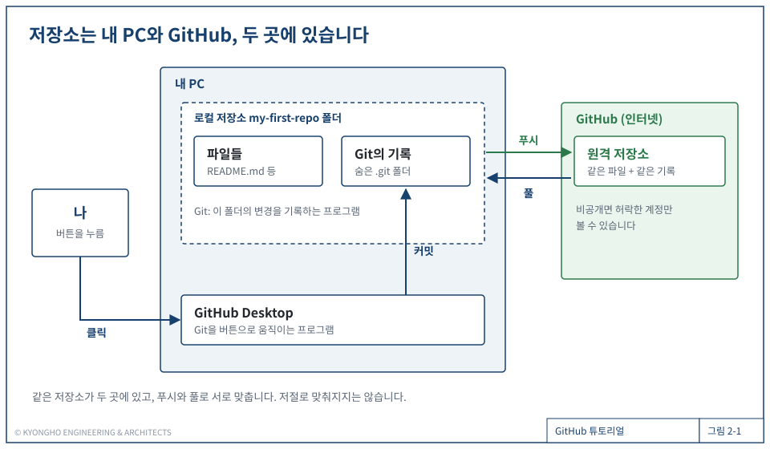
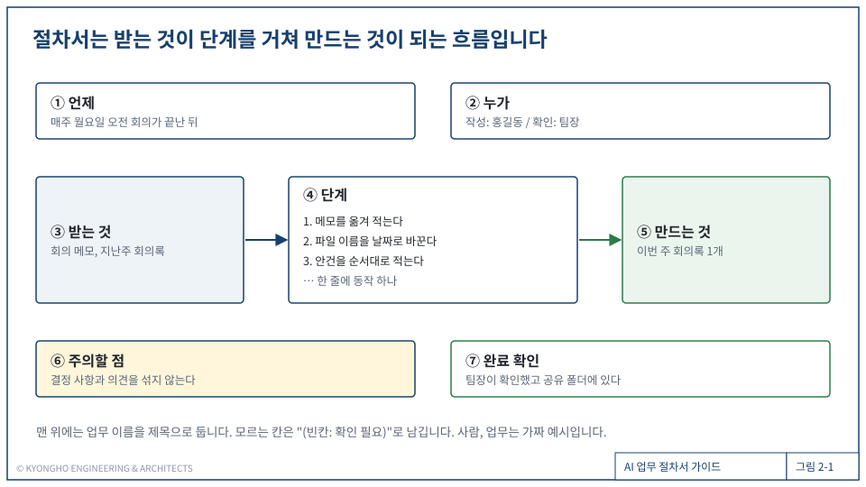
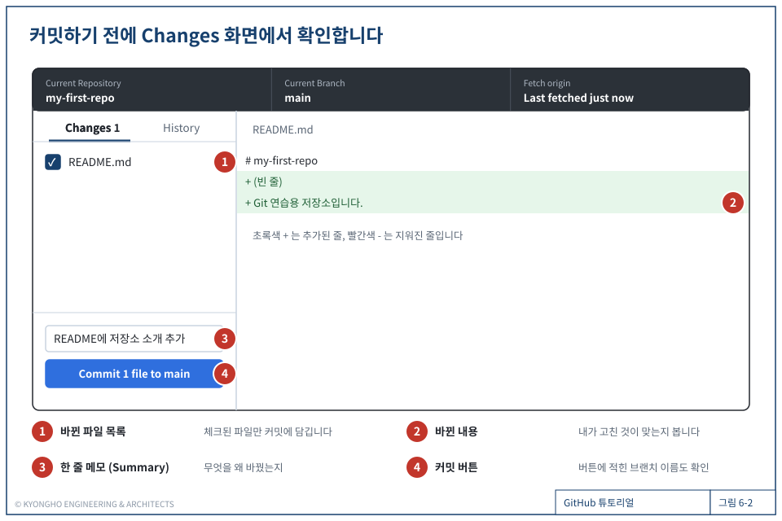
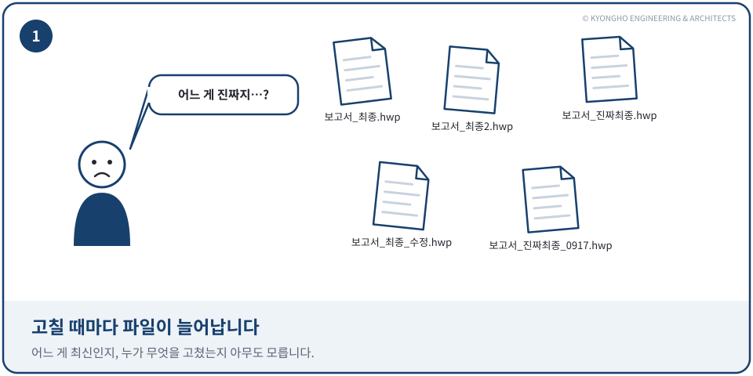

# kh-diagram

교육 자료·문서의 본문 그림(구조도, 흐름도, 화면 설명, 비유 만화)을 **늘 같은 디자인**의 SVG로 그리게 하는 AI 코딩 도구용 스킬입니다. Codex와 Claude Code에서 쓸 수 있습니다.

그림은 SVG를 손으로 쓰지 않고 Python 스크립트로 만듭니다. 색·선·글꼴·프레임·부품은 공용 모듈 `figlib.py`가 고정하므로, AI는 구도와 글만 정합니다. 그래서 누가 몇 번을 그려도 같은 모양이 나옵니다. **Python이 없는 PC**(Windows 기본 상태 등)에서는 같은 값을 담은 SVG 틀을 복사해 좌표와 글만 적는 **틀 방식**으로 그립니다. 프로그램을 따로 설치하지 않아도 됩니다. KYONGHO ENGINEERING & ARCHITECTS AI팀이 사내 교육 가이드와 리서치 글에 쓰는 그림 방식을 그대로 담았습니다.

| 구조 | 칸 나열 |
|---|---|
|  |  |
| **화면 설명** | **비유 만화** |
|  |  |

## 설치

### Codex

Codex에게 이렇게 부탁합니다. Codex에 기본으로 들어 있는 `skill-installer` 스킬이 `~/.codex/skills/kh-diagram`에 설치합니다.

```text
kyong-ho/kh-diagram 저장소의 skills/kh-diagram 스킬을 설치해 줘
```

직접 설치하려면 이렇게 합니다. 한 프로젝트에서만 쓰려면 `~/.codex/skills` 대신 그 프로젝트의 `.agents/skills`에 복사합니다.

```bash
git clone https://github.com/kyong-ho/kh-diagram.git
mkdir -p ~/.codex/skills
cp -R kh-diagram/skills/kh-diagram ~/.codex/skills/
```

설치한 뒤 Codex를 새로 열면 쓸 수 있습니다.

### Claude Code

Claude Code에서 아래 두 줄을 차례로 입력합니다.

```text
/plugin marketplace add kyong-ho/kh-diagram
/plugin install kh-diagram@kh-diagram
```

직접 설치하려면 스킬 폴더를 `~/.claude/skills/`(모든 프로젝트) 또는 프로젝트의 `.claude/skills/`에 복사합니다.

```bash
git clone https://github.com/kyong-ho/kh-diagram.git
mkdir -p ~/.claude/skills
cp -R kh-diagram/skills/kh-diagram ~/.claude/skills/
```

## 쓰는 법

스킬 이름을 몰라도 됩니다. 그림이 필요한 일을 말하면 AI가 스킬을 꺼냅니다.

```text
docs/01-share.md의 그림 자리에 들어갈 그림을 그려 줘. 내 PC의 작업 파일과 공유 드라이브의 파일이 올리기와 내려받기로 서로 맞춰진다는 내용이야.
```

AI는 먼저 Python 3가 있는지(`python3`·`python`·`py --version`이 실제 버전을 출력하는지) 확인하고 방식을 고릅니다. 어느 쪽이든 Python이나 Node를 설치하려 하지 않습니다.

Python이 있으면 아래 일을 합니다.

1. 처음이면 프로젝트에 `scripts/figures/`를 만들고 `figlib.py`, `build.py`, `check.mjs`와 과정 틀을 복사합니다.
2. 그림이 말할 한 문장을 정하고, 비슷한 예시 그림을 본떠 스크립트를 씁니다.
3. `python3 scripts/figures/build.py <과정>`으로 SVG를 만듭니다.
4. `node scripts/figures/check.mjs`로 그림을 PNG로 그려 보고, 글자가 상자를 넘거나 겹치는지 확인해 고칩니다.
5. 원고에 ``를 넣습니다.

Python이 없으면 **틀 방식**으로 아래 일을 합니다. 도면형 그림(구조, 흐름, 칸 나열, 화면 설명)을 그릴 수 있고, 비유 만화형은 Python 방식에서만 그립니다.

1. 틀 `assets/svg-template/frame-S.svg`를 출력 폴더에 `1-01.svg`처럼 복사하고 제목·표제란·높이를 고칩니다.
2. 비슷한 예시 그림의 좌표를 본떠 상자·화살표·번호 원 같은 부품 조각을 적습니다. 색·선·글꼴은 틀의 `<style>` 클래스가 정합니다.
3. SVG를 브라우저로 열어 글자 넘침·겹침을 눈으로 확인하고 고칩니다.
4. 원고에 ``를 넣습니다.

## 필요한 것

- **없어도 됩니다.** Python이 없으면 틀 방식으로 동작합니다. 그림을 열어 볼 브라우저(Edge, Chrome 등)만 있으면 됩니다.
- **Python 3**(있으면): 그림 스크립트로 만들기. 기본 설치만 있으면 됩니다. 비유 만화형 그림과, figlib로 만든 기존 그림을 고칠 때는 Python이 필요합니다.
- **Node.js와 Playwright**(있으면): 렌더링 확인(`check.mjs`)에만 씁니다. 프로젝트에서 한 번 설치합니다. 없으면 AI가 SVG를 브라우저로 열어 확인하도록 안내합니다.

  ```bash
  npm install -D @playwright/test
  npx playwright install chromium
  ```

## 들어 있는 것

```text
skills/kh-diagram/
  SKILL.md                      순서, 지켜야 할 값, 자주 하는 실수
  scripts/figlib.py             공용 모듈(색, 프레임 2종, 부품)
  scripts/build.py              한 과정의 그림을 모두 만듦
  scripts/check.mjs             브라우저로 그려 PNG를 남기고 글자 넘침·겹침을 찾음
  scripts/verify_examples.py    예시 76장을 다시 만들어 기준 그림과 같은지 확인
  references/style.md           그림 규칙의 원본
  references/svg-template.md    틀 방식(Python 없이) 순서, 클래스, 부품 조각
  references/svg-template-examples/  틀 방식으로 다시 그린 기준 그림 3장
  references/examples/          실제로 쓰인 그림 스크립트 5개 과정
  references/reference-svg/     그 결과 SVG 76장(기준 그림)
  assets/course-template/       새 과정 틀(course.py + 예시 그림 1장)
  assets/svg-template/frame-S.svg  틀 방식의 도면형 프레임(색·선·글꼴 클래스, 화살표 머리)
```

같은 모양이 나오는지는 아래로 확인합니다. `기준 그림 76장 모두 같음.`이 나오면 됩니다.

```bash
python3 skills/kh-diagram/scripts/verify_examples.py
```

## 알아 둘 것

- 그림 왼쪽 아래에 `© KYONGHO ENGINEERING & ARCHITECTS`가 들어갑니다. 자기 그림에 쓸 때는 프로젝트에 복사된 `scripts/figures/figlib.py`의 `COPYRIGHT` 값을 바꿉니다. 바꾸면 `verify_examples.py`는 모든 그림이 다르다고 알립니다. 틀 방식은 틀(`frame-S.svg`)의 저작권 줄을 바꿉니다.
- 글꼴은 맑은 고딕(Windows), Apple SD Gothic Neo(Mac), Noto Sans KR 순으로 씁니다. 운영체제에 따라 글자 폭이 조금 다릅니다.
- 예시 그림의 내용(GitHub 화면, 교육 가이드 문장)은 본뜨기 위한 예시입니다.

## 라이선스

[MIT](LICENSE)
